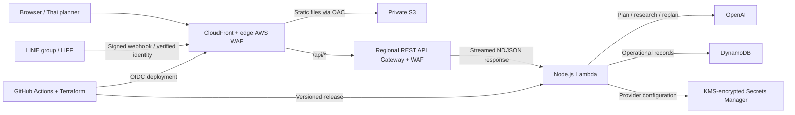

# Bop · ไปด้วยกัน

**Better trips together.** Bop turns “Where should we go?” and “What if the plan changes?” into a shared itinerary, with the trade-offs visible before the group decides.

**Team 37 · Sea × OpenAI Regional Codex Hackathon Thailand · 21 November 2026**

Build direction: **AI-Native Products & Operations** · [Event](https://luma.com/39zve8ph)

[Open Bop](https://d2nlguqr61q2jd.cloudfront.net/) · [Verified deployment](https://github.com/Team37-Bop/sea-x-openai-regional-codex-hackathon-thailand/actions/runs/44887735297) · [Architecture runbook](terraform/README.md) · [OpenSpec](openspec/README.md)

## Judge walkthrough

1. **Plan together.** Start a Chiang Mai trip, add friends with different budgets, walking limits, dietary needs and must-visit places. Let Bop plan immediately or ask the group to choose places first.
2. **Inspect the plan.** Follow the streamed planning stages. Switch between the daily and whole-trip map, open a stop from the itinerary, and compare sourced details with estimates. If the map is unavailable, the itinerary remains usable.
3. **Change one thing.** Ask in Thai to remove a stop that is actually in the itinerary while keeping flights and meals unchanged. Compare changed stops, time and cost; use Undo to restore the previous plan. For a change involving trade-offs, inspect alternatives and the vote flow. A configured LINE group can receive Flex cards and vote from LINE or LIFF; use an authorized test group only.

Bop keeps the edit, the evidence and the group decision in one workflow. It does not treat a chat answer as consensus or a booking.

## How the product works

- **OpenAI at runtime:** interprets Thai requests, researches places, proposes the itinerary and drafts targeted edits. The planner streams progress and partial results into the interface.
- **Deterministic code:** normalizes inputs, schedules and routes stops, checks constraints, calculates before/after differences, and applies vote and undo rules. Unverified prices and route estimates are not guarantees.
- **People:** set preferences, compare options and make decisions. Flight checkout is a separate, explicitly confirmed flow in supported configurations.



**Data flow:** CloudFront serves the frontend from private S3. Planning requests go through API Gateway to Lambda; progress streams back to the browser. The editable plan lives in the browser, while DynamoDB stores operational records such as LINE links, votes, delivery deduplication, and booking idempotency. GitHub Actions tests and packages releases; Terraform manages AWS infrastructure. See the [runbook](terraform/README.md) for environment controls and rollback.

## What is live, configurable, or not built

| Surface | What to expect |
| --- | --- |
| OpenAI planning | Live in the deployed planner when configured. Local fixture mode is available without a model key. |
| Maps, routes and weather | MapLibre GL, OpenFreeMap, and OpenStreetMap-based geocoding/routing (OSRM and Valhalla). Estimated legs are labeled. Open-Meteo supplies forecast context; demo disruption scenarios are not automatic flight or weather alerts. |
| LINE | Group linking, Thai Flex messages and voting are implemented. Requires Messaging API setup plus LINE Login and LIFF for member identity. Set the registered LIFF Endpoint URL to the deployed `/liff.html` (not the LINE default placeholder), then verify a trip link on a real LINE device. |
| Flights and other bookings | Duffel test-mode offer, review, order and cancellation paths. No real ticket purchase or customer payment is being demonstrated. Bop does not make hotel or activity reservations. When a suggested hotel has no rate, the displayed total excludes that cost and does not establish that the trip is within budget. |

## Hackathon work and evidence

The prep repository provided a behavior reference, not the submitted application. During the event, Team 37 built the competition implementation: Thai map-first setup and planning, streamed research, targeted replan with comparison and undo, configurable LINE voting, and the AWS deployment path. The [OpenSpec guide](openspec/README.md) identifies the pinned prep baseline and 15 behavior specifications. The [Codex skills](.codex/skills/) document the spec workflow. See [PR #9](https://github.com/Team37-Bop/sea-x-openai-regional-codex-hackathon-thailand/pull/9) for a Codex-assisted visual change with workflow regression checks and [PR #12](https://github.com/Team37-Bop/sea-x-openai-regional-codex-hackathon-thailand/pull/12) for the LINE Flex release with mocked message checks. Inspect [the implementation history](https://github.com/Team37-Bop/sea-x-openai-regional-codex-hackathon-thailand/commits/main/) and tests for what was built and verified.

| Judging criterion | Evidence to inspect |
| --- | --- |
| Problem & Solution Fit | Multiple travelers, one plan: budget, walking, meals, preferences and timing are visible in setup and checks. |
| Build Quality | Streamed UI, explicit estimates, edit and undo, integration tests and a reproducible AWS release. |
| Insight & Originality | A disruption is a reviewable change to a shared plan, not a regenerated itinerary that hides changes. |
| Real-World Value | Friends can evaluate trade-offs, vote in LINE when configured, and keep track of booking follow-ups. |
| Alignment with Build Direction | AI drives research and replanning; code and people retain control over decisions. |
| Use of Codex | Checked-in OpenSpec workflow, behavior requirements and regression tests make implementation and verification reviewable. |

**Verification and limits:** the verified all-Flex release at [`8013681`](https://github.com/Team37-Bop/sea-x-openai-regional-codex-hackathon-thailand/commit/8013681aed6588cd248ab997fe162147ba9210b8) passed **116 tests** and the production build. A separate live one-day Chiang Mai smoke test verified generation, a Thai request to remove Three Kings Monument while keeping flights and both meals, and Undo restoring the stop. Map initialization failed in that cloud browser; the itinerary still worked. Automated LINE and Duffel checks use mocks or fixtures, not a live group send or real purchase.

**Later release:** [Deploy #47](https://github.com/Team37-Bop/sea-x-openai-regional-codex-hackathon-thailand/actions/runs/44888203085) passed for `3a53501` (hotel recommendations and schedule explanations). The Chiang Mai browser smoke above predates that release; it does not verify the new lodging flow.

## เปิดบนเครื่อง

ใช้ Node.js 24 และ npm จากโฟลเดอร์โครงการ

```sh
npm ci
npm run build
npm start
```

เปิด [หน้าตั้งค่าทริป](http://localhost:8787/) เพื่อเริ่มวางแผน แผนที่พื้นหลังใช้ไทล์จาก OpenFreeMap ผ่านอินเทอร์เน็ต

หากต้องการสร้างทริปด้วย OpenAI ให้คัดลอก `.env.example` เป็น `.env.local` ตั้ง `BOP_PROVIDER=openai` กับ `OPENAI_API_KEY` แล้วเริ่มเซิร์ฟเวอร์ใหม่ โหมด `BOP_FAKE_LLM=1` ใช้ข้อมูลทดสอบเพื่อเดินผ่านหน้าสร้างทริปและเลือกสถานที่ ส่วน Anthropic API และ Claude CLI เลือกได้ด้วย `BOP_PROVIDER` ตรวจโหมดที่เลือกได้ที่ [สถานะบริการ](http://localhost:8787/api/health)

สำหรับเครื่องที่ใช้เดโม ตั้ง `HOST=127.0.0.1` และ `BOP_LOCAL_DEMO=1` เพื่อเปิดทริปที่สร้างเสร็จจากลิงก์เดิม แม้รีสตาร์ตแอป ข้อมูลแผน 8 ทริปล่าสุดอยู่ใน `server/.cache/showcase/` บนเครื่องนั้น

## งานที่ลองได้

- ตั้งปลายทาง วันเดินทาง โรงแรมหลายแห่ง อาหารที่เลี่ยง งบ และระยะเดินของสมาชิกแต่ละคน
- ให้ Bop จัดแผนทันที หรือให้กลุ่มเลือกสถานที่ก่อน ดูความคืบหน้ารายวัน ค่าใช้จ่าย ระยะเดิน เงื่อนไข และแหล่งข้อมูลสถานที่
- สลับแผนที่รายวันกับทั้งทริป เส้นประแสดงช่วงที่ประเมินจากพิกัด ดูการพยากรณ์ฝนจาก Open-Meteo แล้วเลือกว่าจะปรับแผนหรือไม่
- ดูตัวอย่างทางเลือก โหวต ย้อนการแก้ไข และติดตามการจองในแท็บการจอง
- เมื่อกำหนดค่า LINE แล้ว เชื่อมกลุ่มและโหวตผ่านข้อความหรือ LIFF เมื่อใช้ Duffel test token ให้ลองค้นข้อเสนอ ตรวจราคาสุทธิและสัมภาระ ยืนยันจอง หรือขอราคาและยืนยันการยกเลิกแยกกัน
- ปลายทาง LINE webhook คือ `/api/line/webhook` และ LIFF คือ `/liff.html` การเปิดจองตั๋วจริงนอกเครื่องต้องมีการยืนยันตัวตนจาก API Gateway authorizer

## ตรวจ build

```sh
npm test
openspec validate --all --strict --no-interactive
npm run package:lambda
```

คำสั่งแพ็กติดตั้ง dependencies จาก lockfile ทดสอบแอป ตรวจช่องโหว่ระดับ high ของ dependencies ที่ใช้จริง และสร้างเว็บใน `dist/` จากรายการไฟล์สาธารณะที่กำหนดไว้ใน `scripts/build.mjs` เมื่อเพิ่มไฟล์หน้าเว็บให้เพิ่มชื่อในรายการนั้นด้วย ตัวแพ็กตรวจ MapLibre worker และทดสอบ health กับการสตรีมแผนสามวันจาก Lambda ที่บันเดิลใน `.build/lambda/`

GitHub Actions ตรวจ pull request และใช้ OIDC เพื่อ deploy จาก main ไปยัง CloudFront, private S3, API Gateway และ Lambda ทำตาม [คู่มือ Terraform](terraform/README.md) สำหรับ bootstrap, repository variables, การเลือก runtime secret, การตรวจผล และ rollback

[OpenSpec ทั้ง 15 ส่วน](openspec/README.md) ระบุพฤติกรรมและเกณฑ์ทดสอบของการเขียนแอปใหม่ ทักษะ OpenSpec สำหรับ Codex อยู่ใน `.codex/skills/`

เส้นทางตัวอย่างเชียงใหม่ใช้ข้อมูล © [OpenStreetMap contributors](https://www.openstreetmap.org/copyright) และคำนวณผ่าน [OSRM บน routing.openstreetmap.de](https://routing.openstreetmap.de/)
